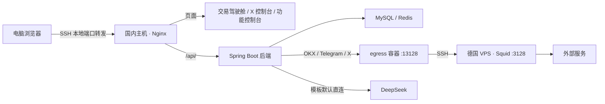

# 项目架构与部署上手指南

第一次接手时，先确认页面、后端和数据分别在哪台机器，再沿对应链路读代码或排障。本地开发从 [项目首页](../README.md) 开始，服务器安装和发布命令集中在 [部署手册](../deploy/README.md)。

## 三台机器与三条连接

国内 Ubuntu 运行后端、数据库、三个管理前端和 Nginx 网关。开发者电脑通过 SSH 访问管理页面。德国 VPS 运行 sshd 和 Squid，为需要代理的客户端提供出口。



| 连接 | 谁建立、谁使用 | 定位问题的入口 |
| --- | --- | --- |
| 电脑访问页面 | 电脑 SSH 客户端把本机端口转发到国内主机的回环端口。浏览器请求同源 `/api/`，网关转发给后端 | [SSH 隧道命令](../deploy/README.md#4-建立电脑访问隧道) · [网关路由](../deploy/nginx/private.conf.template) |
| 后端访问外部服务 | 后端客户端连接 `http://egress:13128`。egress 容器建立 SSH 隧道，由德国 VPS 上的 `127.0.0.1:3128` 接收代理请求 | [egress 启动脚本](../deploy/egress/entrypoint.sh) · [客户端代理配置](../deploy/backend.env.example) |
| 宿主机拉镜像（按需） | 国内宿主机可单独运行 `trade-docker-egress.service`，Docker daemon 通过宿主机 `127.0.0.1:13128` 拉取镜像 | 在宿主机检查 systemd 服务和 `/etc/systemd/system/docker.service.d/trade-proxy.conf`。这两份配置由主机维护者交接 |

在 `ssh -L 127.0.0.1:18080:127.0.0.1:18080` 中，前一个地址是电脑的监听端口，后一个地址由国内主机连接。关闭电脑上的 SSH 窗口会中断页面访问，服务器上的任务继续运行。容器和宿主机各有自己的回环地址，后端要用 Docker 服务名 `egress` 连接业务代理。

## 页面和服务端口

默认私有部署有八个服务。网关的三个宿主机端口绑定回环地址，前端和后端通过 `app` 网络通信，MySQL 和 Redis 通过内部 `data` 网络提供服务。[生产 Compose](../compose.prod.yaml)

| 入口 | 国内主机默认端口 | 网关转发目标 |
| --- | --- | --- |
| 交易驾驶舱 | `127.0.0.1:18080` | `gateway:8080` → `cockpit:3000`，Node SSR |
| X 只读控制台 | `127.0.0.1:18081` | `gateway:8081` → `x-console:8080` |
| 功能控制台 | `127.0.0.1:18082` | `gateway:8082` → `control-console:8080` |
| 管理 API | 通过对应页面的同源路径 | `/api/` → `backend:8080`，路由按页面授权 |

MySQL（3306）、Redis（6379）和 egress（13128）仅在容器网络内提供服务。可选的 `monitoring` profile 启动 Prometheus、Grafana 和 Alertmanager，宿主机回环端口分别为 9090、3001 和 9093。公共 HTTPS 模式需要域名、客户端证书和 Basic 认证。[监控与备份](../deploy/README.md#数据备份和监控) · [公共模式配置](../compose.public.yaml)

## 配置、身份与数据

服务器配置位于 `/opt/trade/deploy/`。交接现有环境时，向维护者取得主机地址与指纹、登录授权、当前镜像清单和备份位置。

| 配置 | 使用者和用途 |
| --- | --- |
| `.env` | Compose 读取基础服务、端口、资源和德国 SSH 连接参数 |
| `backend.env` | 后端读取模块开关、运行模式、外部账户及审核配置。容器内的数据库连接和业务代理地址由 Compose 指定 |
| `release.env`、`releases/` | 发布脚本读取镜像引用，保存当前和上一成功版本。更新运行环境变量后，重新创建 backend 才会加载新值 |
| `secrets/` | 保存转发私钥、已核验的主机指纹文件及操作员密码哈希。浏览器使用个人操作员凭据，外部平台凭据由后端读取 |

管理接口使用 Basic 认证，写请求还要求 `X-Trade-CSRF: 1`。生产模板选择 OKX PAPER、关闭实盘下单，启用交易所 WebSocket 和 Redis 热缓存。X 模板启用生成和审核后发布。功能控制台已保存的模块选择在启动时优先恢复，接手现有环境时应读取实际模块与任务状态。[生产环境变量模板](../deploy/backend.env.example) · [后台任务操作](backend/OPERATIONS.md#后台任务操作)

| 数据 | 存储与恢复方式 |
| --- | --- |
| 活动策略、模拟资金、真实订单与成交、资金停止状态、草稿及发布审计 | MySQL 持久化。标准后端发布先备份数据库，再由 Flyway 在启动时执行待应用版本。[数据库说明](../backend/src/main/resources/db/README.md) |
| 热行情 | Redis 缓存，缺失或故障时可回退行情源。后端对接交易所 WebSocket/REST，浏览器通过 SSE 接收增量行情。[可观测性](backend/OBSERVABILITY.md) |
| 策略画像与近期决策记忆 | 使用后端 `/app/data` 卷中的 `trading-state.json` |
| 历史回测任务与结果 | `BacktestService` 保存在进程内，重启后清空。[回测说明](trading/BACKTEST.md) |

## 从代码跟踪业务

后端按业务域组织在一个 Spring Boot 进程内。一个域的 HTTP 与调度入口位于 `interfaces`，用例位于 `application`，规则位于 `domain`，数据库和外部系统的实现位于 `infrastructure`，出站接口位于模块根目录的 `port`。[模块目录](backend/MODULES.md) · [架构说明](backend/ARCHITECTURE.md)

| 功能 | 调用链与代码入口 |
| --- | --- |
| 后台任务 | 登记交易、Trading AI、Polymarket、微博和 X 循环。应用就绪后恢复模块选择，再按固定延迟调度，同一任务的循环互斥。[任务登记](../backend/src/main/java/com/trade/automation/application/task/AutomationTaskRegistrar.java) · [模块恢复](../backend/src/main/java/com/trade/automation/application/task/ModuleControlService.java) · [任务执行](../backend/src/main/java/com/trade/automation/application/task/AutomationTaskManager.java) |
| OKX 决策与执行 | 定时决策或事件信号 → 行情和账户上下文 → 活动策略 → 风控与数量校验 → PAPER 模拟成交或 LIVE 提交与对账。PAPER 使用公共行情和独立模拟账本，LIVE 还需实盘授权及资金状态检查。[决策引擎](../backend/src/main/java/com/trade/trading/application/strategy/TradingStrategyEngine.java) · [行情采集](../backend/src/main/java/com/trade/trading/infrastructure/market/MarketContextCollector.java) · [模拟账本](trading/SIMULATION.md) |
| X 内容发布 | 生成并保存草稿 → 发送 Telegram 审核消息 → 后端轮询 `getUpdates` 并校验审核人、消息和版本 → 检查发布条件 → 调用 X API。`UNKNOWN` 需先到平台核实，再决定后续处理。[发布用例](../backend/src/main/java/com/trade/x/application/service/XPostService.java) · [X 工作流](publishing/X_WORKFLOW.md) |

## 连接现有环境

1. 按 [电脑访问隧道](../deploy/README.md#4-建立电脑访问隧道) 连接国内主机，保持 SSH 窗口打开。浏览器访问上表的本机端口，用操作员账号登录。
2. 按 [部署验收](../deploy/README.md#5-部署验收) 检查容器、代理和管理 API。可从电脑用下面的只读请求确认交易模式、活动策略和最近一次决策，curl 会提示输入密码。

   ```powershell
   curl.exe --noproxy "*" -sS --max-time 30 -u operator 'http://127.0.0.1:18080/api/trading/runtime/status' |
       ConvertFrom-Json | Select-Object executionMode, liveEnabled, activeStrategyId, lastError, lastDecision
   ```

3. 要核对 X 发布，查看具体草稿的审核状态与平台帖子 ID。要发布新版本，从 GitHub 手动提交 CNB 任务，核对构建、TCR 镜像、服务器发布记录和上述业务状态。[X 工作流](publishing/X_WORKFLOW.md) · [CNB 发布入口](../deploy/README.md#cnb-发布入口)

## 常见问题按链路定位

| 现象 | 先查哪里 |
| --- | --- |
| 页面连不上，或页面能打开但 API 返回 502 | 前者查电脑 SSH 窗口、本地端口和网关。后者查网关到后端的路由及容器健康。[API 路由](../deploy/nginx/includes/api.conf) |
| 能读取状态，但管理写入返回 403 或 409 | 403 查操作员身份、来源和 CSRF。409 重新读取当前版本及业务状态。[后端运维](backend/OPERATIONS.md) |
| 行情有值，决策或推送报错 | 查交易运行状态的 `lastError`、`lastDecision` 和底层接口。分别看后端 WebSocket、REST、缓存及浏览器 SSE，管理任务的运行结果也可在功能控制台查看 |
| 业务代理可用，但 Docker pull 超时 | 在宿主机执行 `systemctl is-active trade-docker-egress.service`。可经宿主机代理请求 `https://registry-1.docker.io/v2/`，返回 401 表示已到达鉴权入口，下载镜像层还需单独核验 |
| 更新了 `backend.env`，服务仍在用旧值 | 通过发布脚本重建后端。仅更新 Compose、Nginx 或业务配置时，先同步对应服务器文件。[发布行为与回滚](../deploy/README.md#发布行为与回滚) |
