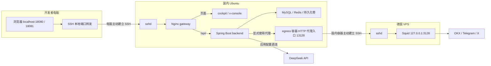
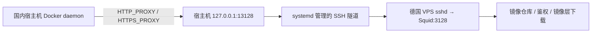
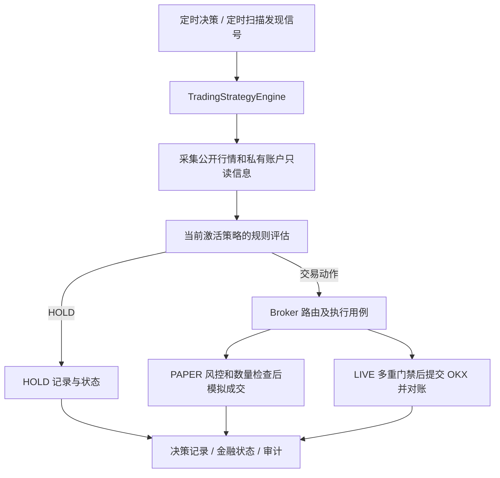

# 项目架构与部署上手指南

[返回文档总导航](README.md) · [后端专题导航](backend/README.md) · [生产部署说明](../deploy/README.md)

面向第一次接手项目的开发者和运维人员。先读第 1～4 节理解系统与通信，再按第 7 节连接现有环境；修改代码、发布与排障分别见第 5、8、9 节。

核对日期：2026-10-18。代码事实以当前仓库为准，运行配置以服务器上的配置和发布记录为准。本文不保存真实主机地址、密码或令牌；示例中的 `CN_HOST`、`DE_HOST` 需要替换为交接提供的地址。

本文依据源码、部署模板及此前提供的部署输出整理，没有重新登录服务器巡检。此前已确认七个生产容器健康、OKX 公共接口代理访问成功、驾驶舱行情及 X 列表可读取、Telegram 可收到审核消息。最近的驾驶舱修复和 OKX 凭据更新是否已完整上线、PAPER 决策是否恢复、是否完成真实 X 发布，仍需按第 7 节逐项验收。

## 1. 先看整体：三台机器各做什么

业务后端、数据库和两个管理前端都在国内 Ubuntu 上运行。德国 VPS 提供网络出口。电脑负责开发、构建镜像和通过 SSH 访问管理页面。

| 位置 | 运行内容 | 职责 |
| --- | --- | --- |
| 开发者电脑，当前为 Windows | 浏览器、SSH/SFTP 客户端、源码、Docker Desktop 或其他构建环境 | 开发和构建 Linux 镜像；上传发布包；访问服务器管理页面 |
| 国内 Ubuntu 主机 | Docker Engine + Compose、后端、两个前端、Nginx 网关、MySQL、Redis、egress 隧道容器 | 执行策略与内容工作流，保存业务数据，提供管理 API |
| 德国 VPS | sshd、Squid | 接收国内主机建立的 SSH 隧道，由 Squid 转发外部请求 |



德国 VPS 不承载本项目后端和数据库；它只提供当前方案中的代理出口。电脑关闭或访问隧道断开，不会停止国内主机上的后台任务。

## 2. 三条通信链路，分别理解

### 2.1 电脑如何访问国内主机上的页面

电脑主动 SSH 登录国内主机，同时建立本地端口转发：

```text
电脑浏览器 127.0.0.1:18080
  → 电脑 SSH 客户端
  → 公网中的加密 SSH 连接
  → 国内主机 sshd
  → 国内主机 127.0.0.1:18080
  → gateway 容器 8080
  → 页面走 cockpit:3000，/api/ 走 backend:8080
```

X 控制台同理，使用电脑和国内主机上的 18081，进入 gateway 的 8081，再读取 x-console:8080。两个前端的 API 都转发给同一个 backend。

关键命令的含义：

```text
-L 127.0.0.1:18080:127.0.0.1:18080
   └─电脑上的监听地址─┘ └─从国内主机连接的目标─┘
```

两个 `127.0.0.1` 分别属于两台机器。浏览器访问 localhost 时，TCP 流量会被电脑上的 SSH 客户端接走，再从国内主机连接网关。浏览器没有直接请求国内主机公网 IP 的 18080。

浏览器读取页面后，JavaScript 再请求同源 `/api/`；生产模式由 Nginx 转发 API，不需要为浏览器填写后端容器地址。驾驶舱行情增量推送使用 **SSE**，不是浏览器与后端之间的 WebSocket。SSE 也经过同一条 SSH 隧道。

网页地址使用本机 HTTP，跨公网的这段传输由 SSH 加密；网关和后端之间使用 Docker 网络内的 HTTP。本方案默认面向获得 SSH 访问权限的管理人员，不是公开网站。

### 2.2 国内后端如何通过德国 VPS 请求外部服务

backend 按客户端配置连接 `http://egress:13128`。egress 是 Docker 服务名，13128 是其容器内监听端口。

```text
backend 中的 OKX / Telegram / X 客户端
  → HTTP 代理 egress:13128
  → egress 容器建立的 SSH 连接
  → 德国 VPS sshd
  → 德国 VPS 127.0.0.1:3128 的 Squid
  → 对应外部 HTTPS 服务
```

egress 的核心转发参数来自 [entrypoint.sh](../deploy/egress/entrypoint.sh)：

```text
ssh -NT -g -L 0.0.0.0:13128:127.0.0.1:3128 trade-proxy@DE_HOST
```

这里的本地是 **egress 容器**，远端是德国 VPS。`0.0.0.0:13128` 允许同一 Docker 网络内的 backend 连接，但 Compose 没有把它发布到宿主机或公网。

SSH 通道只转发 TCP 字节，不执行交易逻辑。Squid 接收代理协议并建立目标连接。对于当前设计中的 HTTPS 目标，客户端经 HTTP CONNECT 建立隧道，再与目标服务进行 TLS 通信；SSH 额外保护国内到德国这一段。仓库没有管理 VPS 的 Squid 配置，本文不能替代对实际 VPS 配置的核验。

响应沿已建立的连接返回，不需要德国 VPS 主动连接国内主机。德国专用用户 `trade-proxy` 的权限目标是仅允许转发到 `127.0.0.1:3128`；部署中使用公钥认证，并核验德国主机指纹。容器 SSH 退出后由 Docker 重启重连。

| 外部服务 | 当前生产模板中的出站方式 | 配置开关 |
| --- | --- | --- |
| OKX REST | egress → 德国 Squid | `TRADE_OKX_PROXY_ENABLED=true` |
| Telegram Bot API | egress → 德国 Squid | `TRADE_TELEGRAM_PROXY_ENABLED=true` |
| X API | egress → 德国 Squid | `TRADE_X_PROXY_ENABLED=true` |
| DeepSeek | 按应用配置直连 | `TRADE_AI_PROXY_ENABLED=false` |

Compose 将前三个客户端的代理地址强制设置为 `egress:13128`。这套配置不会自动代理所有外部网站；新增客户端时要检查该客户端的代理能力。backend 中填写 `127.0.0.1:13128` 会指向 backend 容器自己，而不是 egress。

Telegram 审核使用后端主动 `getUpdates` 轮询，用户在 Telegram 点击的审核操作由轮询取回；当前不依赖公网 webhook，也不需要 Telegram 直接连入国内服务器。

### 2.3 Docker 拉镜像为什么还有另一条隧道

此前交接的国内主机还配置了独立的宿主机服务 `trade-docker-egress.service`：



| 隧道 | 建立位置和维护者 | 谁使用 |
| --- | --- | --- |
| 电脑访问隧道 | 电脑 SSH 进程，人工启动 | 浏览器访问两个管理页面 |
| 业务出站隧道 | egress 容器，Docker 管理 | 后端的 OKX、Telegram、X 客户端 |
| Docker 拉镜像隧道 | 国内宿主机 systemd 服务 | Docker daemon 拉镜像 |

宿主机和 egress 容器可以同时使用 13128，因为它们属于不同的网络空间。宿主机 Docker 代理配置位于 `/etc/systemd/system/docker.service.d/trade-proxy.conf`；这个文件和 `trade-docker-egress.service` 本身**不在仓库中**，新机器需要另行交接或配置。此前启用成功不代表它此刻仍运行，应按第 7 节检查。

Docker daemon 的代理不会自动成为 Java 客户端代理，也不能保证镜像构建中的 npm/Maven 下载已使用代理。当前在电脑或 CI 构建镜像；服务器拉取不稳定时使用镜像归档上传和 `docker load`。

## 3. 服务、端口和网络边界

生产入口是 [compose.prod.yaml](../compose.prod.yaml)，默认七个服务。根目录的 [compose.yaml](../compose.yaml) 主要供本地基础设施使用，两者不要混用。

| 服务 | 容器内入口 | 国内宿主机入口 | 用途 |
| --- | --- | --- | --- |
| gateway | 8080 / 8081 | `127.0.0.1:18080` / `127.0.0.1:18081` | 网关登录、页面与 API 路由 |
| cockpit | 3000 | 不单独发布 | React、Next 兼容 API、vinext Node SSR 交易驾驶舱 |
| x-console | 8080 | 不单独发布 | Vite + 原生 HTML/CSS/JavaScript 的 X 只读控制台 |
| backend | 8080 | 不单独发布 | 一个 Spring Boot 进程，包含全部后端业务域 |
| mysql | 3306 | 不发布 | 业务数据库 |
| redis | 6379 | 不发布 | 可关闭的共享热行情缓存 |
| egress | 13128 | 不发布 | 业务出站 SSH 转发入口 |

国内和德国主机的 SSH 使用各自配置的端口，示例按 22 编写。德国 Squid 的目标是 `127.0.0.1:3128`，不需要向公网开放 3128。

Docker 网络分三组：`app` 连接网关、两个前端和后端；`data` 连接后端、MySQL、Redis，并设置 `internal: true`；`outbound` 连接后端与 egress。backend 同时加入三组。服务名只在相应 Docker 网络内解析，电脑浏览器不能直接访问 `backend:8080`。

Prometheus、Grafana 归可选 `monitoring` profile，默认不启动。启用后宿主机入口仍绑定回环：9090、3001。公共域名/TLS 模式由 [compose.public.yaml](../compose.public.yaml) 提供，是另一种访问方式；本次采用私有模式，未叠加该文件。公共模式会替换网关端口，具体操作见部署说明。

## 4. 配置和认证：每份东西给谁用

### 4.1 运行配置、镜像版本与数据分开

| 文件或目录，服务器位于 `/opt/trade/` | 内容与作用 |
| --- | --- |
| `deploy/.env` | Compose 基础配置：数据库/Redis 密码、德国 SSH 地址、端口、资源限制等 |
| `deploy/backend.env` | 后端运行时业务变量：OKX、AI、Telegram、X 凭据和业务开关；raw 格式，不额外加引号 |
| `deploy/release.env` | 当前应用镜像引用；不放业务凭据 |
| `deploy/releases/` | 发布脚本保存的成功、前一版及目标镜像记录 |
| `deploy/secrets/` | egress 私钥、已核验的 known_hosts、网关密码哈希；不提交仓库 |
| Docker 命名卷 | MySQL 数据、Redis 数据、后端 `/app/data`，独立于容器生命周期 |

配置以 `.example` 模板创建，真实文件不会随代码自动生成。Compose 的 `environment` 可以覆盖 `backend.env` 中的同名项，例如容器代理地址和数据库连接。镜像构建不携带生产凭据；修改环境文件后需要**重新创建 backend**，仅 `docker compose restart` 不会重新加载 env 文件。

### 4.2 四种常见认证不要混用

| 认证 | 在哪里输入或使用 | 作用 |
| --- | --- | --- |
| 国内服务器 SSH 密码或登录密钥 | 电脑 SSH/SFTP | 登录、建立访问隧道、传发布包 |
| gateway 用户 `operator` 与网关密码 | 浏览器弹出的登录框；curl 的 `-u operator` | 进入私有 Web 网关 |
| `TRADE_TRADING_OPERATOR_TOKEN` | 驾驶舱左下角“设置” | 携带 `X-Trading-Operator-Token` 进行策略切换等受保护交易管理操作 |
| `TRADE_X_ADMIN_TOKEN` | X 控制台连接设置 | 携带 `X-X-Admin-Token` 读取 X 草稿与历史 |

两个前端的应用令牌只保存在当前页面内存，刷新后要重新输入。网关会移除向后端转发的 Basic Authorization；应用管理令牌使用自己的请求头。

德国转发密钥只用于国内主机/容器连接德国专用用户，不能拿它当电脑登录国内主机的密钥。OKX 只读凭据、X OAuth 凭据、Telegram Bot Token、DeepSeek Key 均属于后端运行配置，不输入前端、不打进镜像。

### 4.3 当前生产模板的业务安排

以下是 [backend.env.example](../deploy/backend.env.example) 的目标配置，不代表已经读取了服务器实时环境：

| 能力 | 目标安排 |
| --- | --- |
| OKX | 自动任务开启；`execution-mode=paper`、`live-enabled=false`；REST 可用，交易 WebSocket 关闭、热缓存开启 |
| X | AI 生成、Telegram 人工审核和审核后发布开启；真实 X 发布能力开启，但仍必须满足审核与其他门禁 |
| X 生成节奏 | 每轮完成后等待 10800000 ms，即三小时；不是每天固定整点 |
| AI | DeepSeek，模板模型名 `deepseek-flash`，应用配置直连；此处记录模板值，不代表厂商最新型号结论 |
| Polymarket / 微博 / 小说后台任务 | 本次生产模板关闭；代码仍在后端仓库中 |
| 文字游戏 / 集市前端 | 仓库中存在，未包含在本次七服务生产部署中 |

## 5. 代码如何组织，业务如何执行

### 5.1 仓库与后端四层

```text
backend/                    Java 21 / Spring Boot 4 / Maven / MyBatis 后端
frontend/trading-cockpit/    交易驾驶舱
frontend/x-console/          X 内容只读控制台
frontend/text-game/          文字游戏前端
frontend/market/             集市前端
deploy/                     镜像构建、发布、代理容器、Nginx、配置模板
tools/polymarket/            Python 外部交易桥接和调试工具
story/                      小说素材与生成内容
docs/                       文档总导航、交接指南及 backend/ 后端专题
```

后端是按业务域组织的**模块化单体**，不是每个域一个独立微服务。当前业务域包括 trading、x、weibo、polymarket、story、textgame、marketplace；automation 负责跨域任务生命周期，client 负责外部供应商通信，ai 负责共享 AI 审计能力，common 放无业务归属的纯函数。

| 域内目录 | 放什么 | 典型入口 |
| --- | --- | --- |
| interfaces | HTTP 映射、鉴权、请求转换、薄调度入口 | TradingController、TradingScheduler |
| application | 用例编排、事务边界、调用顺序、出站 port | TradingStrategyEngine、XPostService |
| domain | 模型、状态、不变量、纯业务规则 | 阈值策略、风控规则、订单状态机 |
| infrastructure | MyBatis、Redis、文件、Broker、外部接入和配置装配 | MarketContextCollector、TradingStateRepository |

基本方向是 interfaces → application → domain，基础设施实现 application 定义的出站接口。跨域生命周期由 automation 编排。详细规范与完整模块说明分别见 [ARCHITECTURE](backend/ARCHITECTURE.md)、[MODULES](backend/MODULES.md)。

### 5.2 后台任务不是打开网页后才运行

`AutomationTaskRegistrar` 登记任务；应用收到 `ApplicationReadyEvent` 后按 auto-start 配置启动，或通过任务 API 启停。每个循环先等待 initialDelay，执行完成后再等待 fixedDelay。同一任务的循环共用互斥锁，忙时跳过该次执行，不积压排队；实际触发时间还会受执行耗时与其他循环影响。

当前主要节奏：交易决策约每 30 分钟一次、事件扫描约每 60 秒、订单对账循环约每 15 秒；X 生成约每三小时、审核轮询约每 5 秒、发布扫描约每 60 秒。它们是不同循环，后台任务启动也不等于每个业务门禁都已放行。

### 5.3 OKX：决策、执行与回测分开



当前启用的是确定性阈值策略，不是每次交易决策都调用 DeepSeek。配置中的 enabled 策略属于候选，实时决策只运行当前激活的一个策略。策略评估先得到动作建议，风控、数量规则和执行门禁仍可使其变为 SKIPPED；调用到 Broker 也不等于已成交。

**PAPER 目前只模拟成交，不是独立虚拟现金账户。** 决策采集器仍读取 OKX 余额、挂单、历史订单、成交及账户产品规则，因此必须配置只读 OKX 凭据。保持 Read 权限、真实下单关闭；若绑定 IP，使用实际出口德国 VPS 公网 IP。此前 `OKX secret key is required` 正是这一读取阶段失败，不能用公共行情成功来排除。

实时引擎只执行 PAPER / LIVE。历史回测走独立 `BacktestService`、历史行情源和模拟持仓，不通过切换实时模式来启动。回测请求要有 `from`、`to`；提交成功只是入队，最终检查 SUCCEEDED / FAILED 和错误信息。

### 5.4 X：AI 生成、人工审核、发布三个阶段

```text
生成循环 → DeepSeek → 内容校验与保存 → PENDING_REVIEW
  → 后端经代理发送 Telegram 审核消息
  → 人工点击审核 → 后端轮询取回并校验身份、消息与内容版本
  → APPROVED / REJECTED
  → 审核、有效期、配额、账号与发布开关等检查
  → 调用 X API → PUBLISHED / FAILED / UNKNOWN
```

审核通过后可能立即触发一次发布检查，不必一定等到下一分钟。X 控制台目前只读，审核入口在 Telegram。AI 成功不等于已送达审核，Telegram 能收到不等于已经发帖；以具体草稿状态和有效平台帖子 ID 为准。

UNKNOWN 表示外部发布结果不确定，不能当作普通失败自动重发，应先到 X 核对。详见 [X 工作流](backend/X_WORKFLOW.md)。

## 6. 数据存哪里，Redis 和事件总线做什么

Redis 的定位是**共享热行情缓存，减少部分 OKX REST 请求，缺失或故障时回退 REST**。驾驶舱行情查询优先尝试适用的 WebSocket 缓存，再查 Redis，最后请求 REST；当前决策采集器仍直接 REST 采集，不能理解为所有 OKX 请求都会命中 Redis。

REST / WebSocket 行情生产者统一进入有界事件总线，再由隔离的 handler 写 MySQL 或 Redis。队列提供背压/丢弃策略、延迟与处理指标，避免在 WebSocket 回调线程直接做数据库写入。前端读取的 SSE 是另一条推送接口，不等于后端的交易所 WebSocket 接入。

| 数据 | 当前位置 | 容器重建后的情况 |
| --- | --- | --- |
| 订单、成交账本、仓位成本、风险、资金停止状态、X 草稿/审核/发布记录 | MySQL；默认卷 `trade-production_mysql` | 保留卷即可保留数据 |
| 热行情缓存 | Redis；默认卷 `trade-production_redis`，配置 AOF | 仍以缓存语义使用，可回退外部行情 |
| 策略选择、策略画像、有界近期决策记忆 | `/app/data/trading-state.json`；默认卷 `trade-production_backend` | 挂整个目录，保留原子替换后的文件 |
| 回测任务与结果 | 当前 `BacktestService` 进程内内存 | backend 重启会丢失，不应当成持久化回测档案 |
| 日志 | Docker json-file，Compose 限制大小与轮转 | 不是业务数据库或长期备份 |

MySQL 是金融状态权威，JSON 不是跨实例共享资金状态。发布应用镜像不自动升级旧数据库，也不会把 Windows 的开发数据迁移进 Linux 卷。不要删除命名卷来解决普通部署错误；备份与手工 schema 升级见 [生产部署说明](../deploy/README.md) 和 [数据库说明](../backend/src/main/resources/db/README.md)。

## 7. 新人连接现有环境：十分钟操作

先向维护者取得国内 SSH 地址/端口、登录方式、网关账号密码，以及必要的应用令牌授权。以下电脑命令均在 **Windows PowerShell** 执行；服务器命令明确标为 Ubuntu Bash。

### 第一步：打开访问隧道

```powershell
$DomesticSsh = 'ubuntu@CN_HOST'  # 替换 CN_HOST
ssh -NT -o ExitOnForwardFailure=yes -o ServerAliveInterval=30 -o ServerAliveCountMax=3 -L 127.0.0.1:18080:127.0.0.1:18080 -L 127.0.0.1:18081:127.0.0.1:18081 $DomesticSsh
```

首次连接按交接信息核对主机指纹；非默认 SSH 端口增加 `-p 实际端口`。成功后没有业务输出属于正常现象，保持该窗口运行。

打开交易驾驶舱 `http://127.0.0.1:18080` 和 X 控制台 `http://127.0.0.1:18081`，先输入网关账号密码。若电脑本地端口冲突，可将 `-L` 前半段换成未占用端口，远端目标端口不变，并使用相应浏览器地址。

### 第二步：将应用令牌安全复制到剪贴板

另开一个 PowerShell 窗口，重新设置 `$DomesticSsh`。以下默认复制交易操作员令牌；复制 X 管理令牌时仅将 `$key` 改为 `TRADE_X_ADMIN_TOKEN`。

```powershell
$DomesticSsh = 'ubuntu@CN_HOST'
$key = 'TRADE_TRADING_OPERATOR_TOKEN'
if ($key -notin @('TRADE_TRADING_OPERATOR_TOKEN', 'TRADE_X_ADMIN_TOKEN')) { throw '令牌名称无效' }
$reader = 'import sys; from pathlib import Path; print(next(line.split("=",1)[1] for line in Path("/opt/trade/deploy/backend.env").read_text().splitlines() if line.startswith(sys.argv[1]+"=")), end="")'
$token = $reader | ssh -T $DomesticSsh python3 - $key
if ($LASTEXITCODE -ne 0 -or [string]::IsNullOrWhiteSpace($token)) { throw '读取令牌失败' }
Set-Clipboard -Value $token
Remove-Variable token
```

交易令牌粘贴到驾驶舱“设置”并应用，然后重新选择策略；X 令牌粘贴到 X 控制台的连接设置。不要在聊天或工单中发送令牌，也不要打印整个环境文件。

### 第三步：只读验收，分清进程健康与业务结果

在电脑 PowerShell 检查网关和业务 API，curl 会询问网关密码：

```powershell
curl.exe --noproxy "*" -sS --max-time 30 -u operator 'http://127.0.0.1:18080/api/trading/runtime/status' | ConvertFrom-Json | Select-Object executionMode, liveEnabled, activeStrategyId, lastError, lastDecision
curl.exe --noproxy "*" -sS --max-time 30 -u operator 'http://127.0.0.1:18080/api/trading/market/candles?instId=BTC-USDT&bar=5m&limit=2'
curl.exe --noproxy "*" -sS --max-time 30 -u operator 'http://127.0.0.1:18080/api/automation/tasks'
```

运行状态应符合 PAPER、liveEnabled=False；最新一次决策完成后再检查 lastError 和 lastDecision。automation 的 lastRunSuccessful 只表示调度入口没有向外抛异常；交易引擎可能捕获错误并保存到自己的 lastError。

在 **国内 Ubuntu Bash** 定义日常命令并查看容器：

```bash
cd /opt/trade
dc() { docker compose --env-file deploy/.env --env-file deploy/release.env -f compose.prod.yaml "$@"; }
dc ps
dc logs --since=20m --tail=100 backend egress gateway
```

从 backend 容器验证完整业务代理链，公开时间接口不会下单：

```bash
dc exec -T backend curl --noproxy "" -fsS --max-time 20 --proxy http://egress:13128 https://www.okx.com/api/v5/public/time
```

检查宿主机的镜像下载隧道：

```bash
systemctl is-active trade-docker-egress.service
curl --noproxy "" -sS --connect-timeout 10 --max-time 30 --proxy http://127.0.0.1:13128 -o /dev/null -w 'Registry HTTP %{http_code}\n' https://registry-1.docker.io/v2/
```

Registry `/v2/` 返回 HTTP 401 是到达鉴权入口的正常挑战，不能证明 token 服务和所有镜像层下载都可用。egress healthy 只证明转发监听存在；网关 `/healthz` 只证明网关进程。分享日志前清理账户和凭据信息；Compose 配置语法检查使用 `config -q`。

## 8. 后续如何迭代部署

长期发布流程是“代码 → 构建带版本号镜像 → 传输镜像和清单 → 校验 → 发布 → 业务验收”。服务器运行镜像，不需要长期保留前端 node_modules 或在小规格主机上执行 Maven/npm 构建。

1. 在电脑、WSL/Linux 或 CI 修改代码并完成离线测试；Docker Desktop 使用 Linux Engine，当前主机目标为 linux/amd64。
2. 用 [build-images.sh](../deploy/scripts/build-images.sh) 生成 backend、cockpit、x-console、egress 镜像和版本清单；Dockerfile 内部完成打包。镜像仓库可达时推送/拉取；当前环境也可使用 `docker save`、SFTP、`docker load`。
3. 上传时保留 SHA256 校验。SFTP 可续传，但续传基于已有部分文件，最终仍要校验完整内容。首次离线部署还需 MySQL、Redis、Nginx 基础镜像。
4. 保留服务器原有业务配置、密钥和数据卷；如果改了部署模板或脚本，同步上传相应文件。不是每次只传镜像就一定足够。
5. 在服务器先 validate，再发布选定服务；发布脚本会重建选中的容器。后端重建会中断 API，并按原配置重新启动后台任务。

服务器 Ubuntu Bash 示例，假定新镜像已 load、新的完整清单位于 `deploy/new-release.env`：

```bash
cd /opt/trade
bash deploy/scripts/release.sh validate --release deploy/new-release.env
DEPLOY_WAIT_TIMEOUT=300 bash deploy/scripts/release.sh deploy cockpit --release deploy/new-release.env --no-pull
```

仅后端变更时将 `cockpit` 换成 `backend`；二者一起更新用 `deploy backend cockpit`。只有更新配置、仍使用原镜像时，也可以用现有清单 `deploy backend --no-pull` 来重新创建后端。默认不写服务名会更新五个应用服务，不适合作为每次小改动的默认动作。

清单必须包含四项 `BACKEND_IMAGE`、`COCKPIT_IMAGE`、`X_CONSOLE_IMAGE`、`EGRESS_IMAGE`，即使只更新一个服务也是如此。单服务发布会保留其他服务的成功镜像记录；`--no-pull` 会先确认所需镜像存在，再停止容器。validate 不启动容器，也不代表外部网络已通过验收。

成功后脚本更新 `deploy/release.env` 和 `deploy/releases/current.env`，保留 `previous.env` 及历史记录。需要回到上一成功镜像版本时：

```bash
bash deploy/scripts/release.sh rollback --no-pull
```

这是显式操作，不是自动回滚。回滚前确认历史镜像仍在；镜像回滚不恢复数据库、业务 env、密钥、网关文件或已经发布的内容。若只回滚选中服务，可指定服务名并按部署说明选择目标清单；数据库升级必须单独安排备份和迁移。首次发布尚无 previous，不能使用上一版回滚。

本机 `A:\trade-deployments\` 下的历史更新包属于本地发布产物，不是克隆仓库后自动具备的工具。复用具体包前核对其版本、目标主机和校验值；可重复的通用入口以仓库 deploy/scripts 为准。

## 9. 常见问题按链路定位

| 现象 | 先检查哪里 |
| --- | --- |
| 电脑 localhost 页面无法连接 | 电脑 SSH 窗口是否仍运行、本地端口是否冲突、国内 SSH 是否可达；然后检查 gateway |
| 页面可打开但 API 502 | gateway → backend；检查后端容器健康和日志，不先归因于德国 VPS |
| 读操作正常，切换策略 403 | 驾驶舱交易令牌是否正确、刷新后是否重新填写；409 则先刷新策略版本 |
| 新建回测 400 | 起止时间、策略、标的及其他请求参数；进入队列后的 FAILED 另看运行错误 |
| 行情能读，决策报 OKX GET request error | 查看最底层 Caused by；当前 PAPER 也依赖私有账户读取，检查三个 OKX 配置是否齐全、只读权限和出口 IP |
| WebSocket 未就绪但行情有值 | 当前模板关闭交易所 WS，REST/Redis 仍可供行情；与浏览器 SSE 是不同层次 |
| Docker pull 超时，业务代理正常 | 宿主机 trade-docker-egress.service 与 Docker daemon 代理；它们不是 egress 容器 |
| 大镜像上传 Connection reset / Broken pipe | 传输中断；对同一归档续传，完成后 SHA 校验；未执行发布时原容器仍运行 |
| 改了 backend.env 似乎没生效 | 同步脚本不重启服务；通过 release.sh 重建 backend，不是只 restart |
| automation 显示成功但没有决策 | 查看 trading runtime 的 lastError / lastDecision；循环未抛错不等于决策成功 |
| Telegram 收到审核，X 没发出 | 查看草稿 status / lastError、审核版本、目标账号和发布门禁；UNKNOWN 先人工核对 |
| 后端重启后回测列表消失 | 当前回测记录存内存；不是 MySQL 丢数据 |

只筛选最近交易错误及底层原因的服务器命令，复制整行执行：

```bash
dc logs --since=2h --no-color backend 2>&1 | grep -A 70 -F 'OKX strategy decision failed' | grep -E 'OKX strategy decision failed|Caused by:|^[[:space:]]*(java\.|javax\.|org\.)' | tail -n 35
```

## 10. 交接时提供什么，从哪里继续读

维护者应通过受控渠道交接：国内/德国主机 SSH 地址与端口、主机指纹、登录授权、网关账号、必要的应用令牌、当前镜像清单、备份位置，以及宿主机 systemd 隧道/Squid 的配置维护方式。共享文档只记录字段名和职责，不写真实密钥。

| 想了解的内容 | 入口 |
| --- | --- |
| 首次安装、密钥权限、网关、发布、备份、公共模式 | [生产部署说明](../deploy/README.md) |
| 后端全部能力、开发启动 | [backend README](../backend/README.md) |
| 业务模块边界 | [MODULES](backend/MODULES.md) |
| 四层职责和调用链 | [ARCHITECTURE](backend/ARCHITECTURE.md) |
| 后台任务怎么注册/启动 | [Registrar](../backend/src/main/java/com/trade/automation/application/task/AutomationTaskRegistrar.java)、[Manager](../backend/src/main/java/com/trade/automation/application/task/AutomationTaskManager.java) |
| 决策与 PAPER 账户读取 | [StrategyEngine](../backend/src/main/java/com/trade/trading/application/strategy/TradingStrategyEngine.java)、[MarketContextCollector](../backend/src/main/java/com/trade/trading/infrastructure/market/MarketContextCollector.java) |
| 回测参数与结果 | [回测说明](backend/TRADING_BACKTEST.md) |
| X 审核与发布 | [X 工作流](backend/X_WORKFLOW.md)、[XPostService](../backend/src/main/java/com/trade/x/application/service/XPostService.java) |
| 电脑外的业务 SSH 隧道 | [egress entrypoint](../deploy/egress/entrypoint.sh) |
| 页面/API 到底转发给谁 | [私有网关](../deploy/nginx/private.conf.template)、[API 路由](../deploy/nginx/includes/api.conf) |
| 交易驾驶舱和 X 控制台的开发方式 | [cockpit README](../frontend/trading-cockpit/README.md)、[x-console README](../frontend/x-console/README.md) |
| 配置同步、镜像构建与发布脚本 | [sync](../deploy/scripts/sync-backend-config.ps1)、[build](../deploy/scripts/build-images.sh)、[release](../deploy/scripts/release.sh) |

后续修改端口、网关、代理方式、数据归属或后台门禁时，同时更新本文对应章节和原始配置模板；实际发布成功版本以服务器记录为准。
